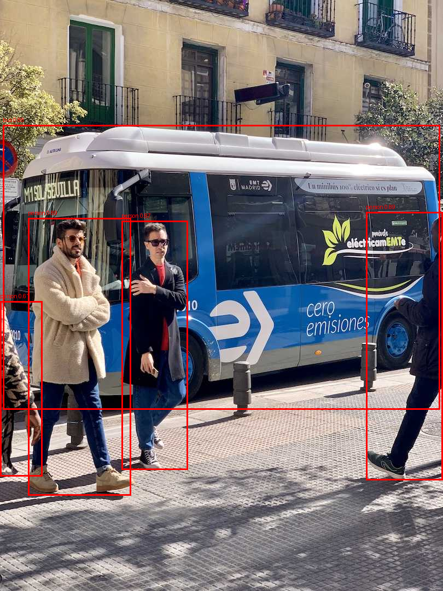

# AI-Ready V4L2 Camera Driver for Embedded Linux

A custom Linux V4L2 camera driver built from the kernel layer upward, using
the videobuf2 (vb2) framework for buffer management and streaming.

The project connects a kernel-space V4L2 device to a userspace computer-vision
pipeline, covering:

- Linux kernel module and V4L2 device implementation
- videobuf2 buffer queue management and MMAP streaming
- YUYV pixel-format negotiation
- Synthetic frame generation for hardware-independent driver development
- Userspace frame capture through `/dev/video0`
- YOLOv8n inference with ONNX Runtime and OpenCV
- Non-Max Suppression (NMS) and bounding-box visualization
- Per-stage wall-clock and CPU-time benchmarking
- Stability and robustness testing
- Investigation of DMA-BUF export and zero-copy constraints

The goal was to understand the complete path from a Linux video driver to
userspace processing rather than treating the camera as a black box.

> **Project scope:** The camera source is intentionally synthetic. This
> project focuses on V4L2 architecture, kernel buffer management, streaming,
> and the kernel-to-userspace boundary rather than real sensor hardware.

## Architecture

The project is split into a kernel-space V4L2 producer and a userspace
processing pipeline.


```text
┌──────────────────────────────────────────────┐
│              Linux Kernel Space              │
│                                              │
│  Custom V4L2 Driver                          │
│  ├── v4l2_device / video_device              │
│  ├── V4L2 ioctl operations                   │
│  ├── Format negotiation (YUYV)               │
│  ├── videobuf2 (vb2) queue                   │
│  └── Kernel-thread frame generation          │
│                    │                         │
└────────────────────┼─────────────────────────┘
                     │
                     │ /dev/video0
                     │
                     ▼
┌──────────────────────────────────────────────┐
│             Userspace (Python)               │
│                                              │
│  V4L2 Capture                                │
│       │                                      │
│       ▼                                      │
│  MMAP Frame Buffer                           │
│       │                                      │
│       ▼                                      │
│  Preprocessing                               │
│       │                                      │
│       ▼                                      │
│  YOLOv8n / ONNX Runtime                      │
│       │                                      │
│       ▼                                      │
│  Non-Max Suppression (NMS)                   │
│       │                                      │
│       ▼                                      │
│  Bounding Boxes / Visualization              │
│                                              │
└──────────────────────────────────────────────┘
                     │
                     ▼
              Performance Metrics
        (wall-clock + CPU time per stage)

```

## Why I Built This

I use cameras, video calls, and AI-powered applications every day, but I
wanted to understand what actually happens underneath the application layer.

What does the operating system do when an application asks for a video
frame? How does a camera become `/dev/video0`? How are buffers allocated,
queued, streamed, and delivered to userspace?

Instead of starting with a high-level camera library, I built the pipeline
from the Linux kernel side upward.

The project became a practical way to learn how V4L2, videobuf2, memory
buffers, streaming, userspace capture, and computer-vision processing fit
together as one system.

## Current Status

The core V4L2 driver and userspace processing pipeline are implemented and
verified. The project has progressed from a basic kernel module to a
working V4L2 streaming device, userspace frame capture, AI inference,
benchmarking, robustness testing, and a final end-to-end demonstration.


| Feature | Status |
|---|---|
| V4L2 capture device registration, `/dev/video0` | Done |
| 'VIDIOC_QUERYCAP' | Done |
| Pixel format: YUYV 640x480 only | Done (single fixed format) |
| 'REQBUFS' / QUERYBUF / QBUF / DQBUF (mmap) | Done (via vb2 helpers) |
| 'STREAMON' / 'STREAMOFF' + synthetic frame generator | Done |
| Userspace capture through OpenCV's V4L2 backend | Done |
| YOLOv8n detection + NMS + box drawing (on a still photo) | Done |
| V4L2 capture-to-inference pipeline benchmarking | Done |
| Per-stage benchmarking, 2500-frame stability run | Done |
| DMA-BUF export / zero-copy | Not achieved (see Limitations) |
| Final demonstration | Complete |


## Verification

| Test | Result |
|---|---|
| Load/unload, normal use | Clean `dmesg`, no warnings from the module |
| `v4l2-ctl --list-devices`, `--info`, `--get/--set-fmt-video` | Correct output; format negotiation works |
| `v4l2-ctl --stream-mmap --stream-count=5 --verbose` | REQBUFS, QUERYBUF x4, QBUF x4, STREAMON all succeed; 5 frames dequeued, each `bytesused: 614400` |
| Save 10 frames to a file | 5.9 MiB, matching 10 x 614,400 bytes |
| Second REQBUFS while a stream is active | Rejected with "Device or resource busy" |
| Ctrl+C mid-stream | `stop_streaming` runs and the capture thread exits cleanly |
| `rmmod` while streaming | Refused by the kernel ("Module is in use"); succeeds after streaming stops |
| Detection on a real photo (Ultralytics `bus.jpg`) | Boxes around the bus and pedestrians after NMS; the first version drew invisible boxes because of a coordinate-scaling bug (fixed) |
| 2500-frame pipeline run (about 10 min) | Python process peak memory 135 MB, then 169 MB after the first 100 frames, then 171 MB by frame 2400; no sign of a leak in userspace |

Not done: a 50x rapid open/close/stream loop (my VM became unresponsive during robustness testing),
`v4l2-compliance`, and kernel-side leak checking (kmemleak). The 2500-frame figure measures the userspace
process only.

## Benchmarks

Environment: Ubuntu Server 26.04 (kernel 7.0.x) in VirtualBox, 2 vCPUs, CPU-only inference, YOLOv8n via
ONNX Runtime default threading, 640x480 input. Frames come from the driver, so there are 0 detections.

100-frame run (per-frame averages):

| Stage | Wall (ms) | CPU (ms) |
|---|---|---|
| Capture (`cap.read`) | 5.6 | 6.2 |
| Preprocess (resize/normalize) | 10.1 | 11.2 |
| Inference | 153.7 | 180.3 |
| Postprocess (box decode + NMS) | 58.7 | 193.6 |
| **Total** | **228.1 (about 4.4 fps)** | |

2500-frame run: 221.1 ms/frame (about 4.5 fps), consistent with the 100-frame run.

**Read these numbers with care:**
- The same code ran from about 220 ms to about 1450 ms per frame across runs (for example, a default-threading
  re-run later in a long session gave 714.7 ms). I saw a tendency toward slower runs later in long VM sessions
  but did not confirm the cause with a controlled test.
- Capture time is low because the consumer is much slower than the generator, so a buffer is always ready. It
  is not a measure of maximum driver throughput, which I did not measure. The generator thread sleeps 33 ms per
  buffer, an upper bound of roughly 30 fps.
- The benchmark input has no objects, so postprocess/NMS cost on real scenes is not represented.

## Demo

The final demonstration shows the complete userspace AI pipeline and the
V4L2 capture workflow.

### YOLOv8n detection + NMS

The pipeline processes a test image using YOLOv8n, applies Non-Max
Suppression, and draws the final bounding boxes.



The final result contains 5 detections after NMS:
- 4 people
- 1 bus

### V4L2 driver demonstration

The Day 29 demonstration videos show the project running through the Linux
V4L2 device and userspace processing workflow.

GitHub does not render these large Git LFS video files directly in the
repository view, so the full recordings are provided as downloadable
artifacts:

- [V4L2 driver demo — Part 1](userspace/day29-demo/V4l2-driver-demo%20part%201.mp4)
- [V4L2 driver demo — Part 2](userspace/day29-demo/V4l2-driver-demo%20part2.mp4)

The complete demonstration files, inference script, test image, model, and
output image are also available in
[`userspace/day29-demo/`](userspace/day29-demo/).


## Limitations & Engineering Findings

- **Synthetic camera source:** The driver generates solid-color frames from
  a kernel thread rather than receiving data from a physical image sensor.
  This was an intentional scope decision to focus on V4L2 architecture,
  videobuf2 buffer management, streaming, and the kernel-to-userspace
  boundary.

- **CPU-only AI inference:** The development environment is a 2-core
  VirtualBox Ubuntu VM without GPU passthrough. YOLOv8n inference is
  therefore CPU-bound and dominates the per-frame processing time.

- **ONNX Runtime thread experiment:** Explicitly configuring the runtime
  thread count to match the VM's 2 cores resulted in significantly worse
  performance because of thread contention. The experiment was reverted
  and the runtime's default threading configuration was retained.

- **DMA-BUF zero-copy:** DMA-BUF export was investigated as a stretch goal.
  The experiment exposed an architectural limitation of the synthetic
  hardware-free driver: the driver is registered without a real parent
  `struct device`, which is required by the DMA-contiguous allocation path
  investigated. The zero-copy path was therefore not claimed as complete.
  The investigation and blocker are documented in
  [`docs/day22-dmabuf-study/`](docs/day22-dmabuf-study/).

- **Virtualized performance variability:** Benchmark performance varied
  across VM sessions. The reported benchmark represents a consistent
  measurement run rather than a claim about production hardware
  performance.

These constraints define the scope of the project rather than being
hidden from the results. The implementation intentionally prioritizes
understanding the Linux video pipeline and documenting the engineering
trade-offs encountered along the way.

## Project Structure

driver/ — kernel module source code, organized by development day
docs/ — daily development log, architecture notes, diagrams,
benchmark data
userspace/ — AI inference consumer application

## Development Log

Full day-by-day build log, including every bug hit, its root cause, 
and what I learned from each, is in [docs/devlog.md](docs/devlog.md).


## Tech Stack

### Kernel / Driver
- Linux kernel
- C
- V4L2 (Video4Linux2)
- videobuf2 (VB2)
- Kernel threads
- MMAP buffer streaming

### Userspace / AI
- Python 3
- OpenCV
- ONNX Runtime
- YOLOv8n
- NumPy

### Development / Testing
- Ubuntu Linux
- VirtualBox
- Git / GitHub
- Git LFS
- `v4l2-ctl`
- GCC / Linux kernel build system

### Concepts Explored
- V4L2 device registration and ioctl flow
- Videobuf2 buffer lifecycle
- MMAP streaming
- Kernel/userspace boundaries
- Frame capture and preprocessing
- Object detection and NMS
- Wall-clock vs CPU-time benchmarking
- Multithreading and performance tuning
- DMA-BUF architecture and zero-copy constraints

## Author

Unnati Chaturvedi - Final year ECE student at Pandit Deendayal Energy University, building toward embedded AI/hardware 
engineering roles.
